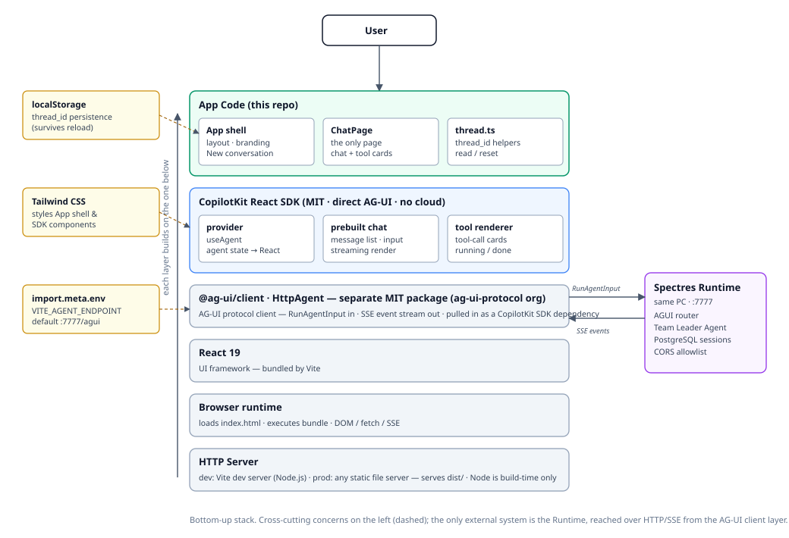

# Spectres Web Client — Frontend Architecture

> The living description of this project's design. Updated in place as the
> app evolves. Product vision and cross-layer decisions are owned by the
> Runtime project (`../Spectres-Runtime/docs/architecture.md` and
> `docs/adr/`); this document covers only the frontend.
>
> Last updated: 2026-11-01 · Covers: v0.3.1 (Minimal Admin Console)

---

## 1. Overview

Spectres-Web-Client is a **static single-page application** with two
role-selected product surfaces. Ordinary users chat with the Spectres Runtime
Master Agent over AG-UI; administrators with the Runtime JWT's
`agent_os:admin` scope see a management-only console. It has no backend of
its own: the build output (`dist/`) is plain HTML/JS/CSS that any HTTP server
can host, and the browser talks directly to the Runtime.



MVP topology: Runtime (`localhost:7777`) and this app (dev server or a
static server over `dist/`) run on the same home PC; the browser is on that
PC. Cross-origin calls are permitted by the Runtime's `CORS_ALLOWED_ORIGINS`
allowlist. No tunneling, no remote access, no cloud.

## 2. Layered Stack (bottom-up)

Each layer builds only on the layers below it; nothing reaches sideways or
upward. See the diagram above for nesting.

### 2.1 HTTP Server

Serves the static build (`index.html` + bundled assets). Dev: Vite dev
server. Prod: any static file server over `dist/`. This is the *only*
server-side concern of the project — there is no application backend.

**Node.js is a build-time-only toolchain**: it runs the bundler (Vite) and
the dev server, and nothing else. The production artifact is plain static
files — no Node process, no runtime server dependency.

### 2.2 Browser runtime

Loads `index.html`, executes the bundle. Provides DOM, `fetch`/SSE, and
`localStorage` — the only platform APIs the app relies on.

### 2.3 React 19

The UI framework. Bundled by Vite; strict TypeScript throughout.

### 2.4 AG-UI protocol client — `@ag-ui/client` `HttpAgent`

The chat wire layer. POSTs `RunAgentInput` to the configured endpoint and
consumes the SSE event stream (text deltas, tool-call lifecycle, state
snapshots, run lifecycle). Runtime REST APIs use the shared fetch layer in
`src/lib/runtime-api.ts`; neither stack talks to any backend other than the
Runtime. The AG-UI agent is constructed only inside the ordinary-user
surface, so admin mode makes no `/agui` requests.

Note: `@ag-ui/client` is a **separate MIT package** maintained by the
`ag-ui-protocol` organization — not part of the CopilotKit SDK. It is the
protocol implementation and an independently versioned package. The app
imports it directly in `ag-ui.ts` to construct the `HttpAgent` that the
CopilotKit provider self-manages (direct connection, no runtime).

**Version pinning convention** (since v0.1.4): `@ag-ui/client` is pinned
to the **exact** version that `@copilotkit/react-core` depends on
(currently `1.0.2`, pinned by CopilotKit 1.77/1.78), with no semver
range. `AbstractAgent` declares private fields, so TypeScript
assignability is nominal — a `HttpAgent` only satisfies CopilotKit's
`selfManagedAgents` slot when both packages resolve to the *same*
installed copy. A caret range (or a Dependabot bump of either side alone)
can install two copies and break the build. The two packages are always
bumped together: when Dependabot opens a solo `@ag-ui/client` (or
CopilotKit) PR that breaks the pairing, close it and do a paired manual
upgrade instead. Verify after every CopilotKit upgrade with
`npm ls @ag-ui/client` (must show one deduped copy).

**AG-UI 1.0 behavior notes**: the 1.0 client validates the event stream —
unknown event types are dropped and unknown properties stripped with
warnings, malformed values fail the run — and stamps every request with
`protocolVersion: "1.0"`. An always-on compatibility boundary translates
legacy 0.x producer shapes (e.g. Agno's current `/agui` stream) with
console warnings, so the Runtime does not need a matching upgrade;
warnings about legacy `null` fields or transformed events are expected
until Agno emits native 1.0 shapes.

### 2.5 CopilotKit React SDK (MIT)

Sits on React and the AG-UI client. Four pieces are used:

- **provider / `CopilotKit`** (from `@copilotkit/react-core/v2`): owns the
  agent connection and exposes agent state as React state. The agent
  instance is passed via `selfManagedAgents` — a direct AG-UI connection
  with no CopilotKit Runtime, no CopilotKit Cloud, no API keys.
  `showIntelligenceIndicator={false}` opts out of the per-turn
  Intelligence indicator (a CopilotKit Cloud feature; there is no
  Intelligence backend to report on).
- **prebuilt chat component** (`CopilotChat` from the same v2 surface):
  message list, streaming rendering, input. Its built-in English labels
  (placeholder, welcome message, disclaimer, toolbar tooltips) are fed
  from the i18n layer (§4).
- **built-in generic tool-call renderer** (`useDefaultRenderTool`): tool
  calls appear as cards with running/done states. It is the wildcard
  (`"*"`) fallback for every tool without a named renderer.
- **custom tool-call renderers** (`useRenderTool` from the v2 surface,
  since v0.2.1): name-matched cards registered per Runtime tool, taking
  precedence over the wildcard fallback. Registration is a extension
  extension point (§3); the v2 API requires a Standard Schema (zod) for
  each tool's `parameters` and delivers render props as a discriminated
  union on `status` (`inProgress` / `executing` / `complete`), with the
  JSON `result` string available only at `complete`.

Styling note: current CopilotKit components are themselves styled with
Tailwind utilities (the SDK depends on `tailwind-merge` /
`tw-animate-css`), so our Tailwind usage for layout is the same styling
system the components use — no compatibility shim needed. Theming note:
the v2 stylesheet reads the same shadcn-style semantic CSS variables as
the app shell (`--background`, `--card`, `--primary`, …) and ships its own
dark values under `.dark [data-copilotkit]`, so putting `.dark` on the
root element darkens the shell and the chat surface together (§2.6).

### 2.6 shadcn/ui component library (vendored)

The shell's controls come from **shadcn/ui** (owner decision — no
hand-rolled UI controls outside the chat surface). Per shadcn's
distribution model, component sources are **vendored into
`src/components/ui/`** (they are our code, editable); behavior comes from
the npm-installed **Radix UI** primitives (`radix-ui` package) and icons
from **`lucide-react`**. `components.json` records the setup (path alias
`@/` → `src/`, Neutral base color, CSS variables); new components are
added with `npx shadcn@latest add <name>`.

**Theme token convention**: a single token file (`src/index.css`) defines
the official shadcn **Neutral** palette as semantic CSS variables in
`:root` (light) and `.dark` — background/foreground, card, popover,
primary/secondary, muted, accent, destructive, border/input/ring, chart,
and the `sidebar-*` set. Both the shell and the CopilotKit chat surface
read these variables, so one token file themes the whole app. **No custom
colors**: only the official palette; the root element carries `class="dark"`
(dark is the default; a toggle is a later nicety).

### 2.7 App code (this repo)

The thinnest layer — everything above is library code:

- **Role boundary** (`src/components/auth-gate.tsx`): owns the in-memory
  `loading | user | admin` state and current token `sub`. While loading it
  renders only the shared loading screen. Admin and ordinary surfaces are
  mutually exclusive mounts; a role change unmounts the old surface before
  the new one appears. Admin mode never mounts `App`, `ChatPage`, CopilotKit,
  a thread agent, or extension views.
- **App shell** (`src/components/app-shell.tsx`): the sidebar frame built
  from shadcn Sidebar primitives. Assistant mode has the upper nav, Extensions,
  and Recent groups; admin mode exposes only the management entry. Both
  modes share the brand, collapse behavior, user area, and sign-out flow. All
  copy is resolved from the i18n layer (§4).
- **AdminPage** (`src/pages/admin-page.tsx`): reads public `/info` for the
  Runtime name, AgentOS instance version, Agno version, auth mode, and user
  isolation; lists and updates the Runtime UserDirectory through `/users`.
  The page distinguishes directory users from Logto accounts, labels AgentOS
  rather than Spectres release versions, paginates with response `meta`, and
  keeps enable/disable pending, confirmation, self-disable, and error states.
- **Navigation registry** (`src/nav.ts`): core sidebar entries are typed
  data (`NavItem` / `ExtensionGroup` / `RecentConversation`) holding
  translation **keys**, not copy. Extension entries are **not** registered
  here — they come from the extension framework (§3).
- **View state**: no router; the active view (`ViewId`) is local React
  state in `app.tsx` — the `"chat"` literal widened to include any
  extension-contributed view id. The chat page stays mounted (hidden) while
  a extension view is shown, so the conversation survives view switches.
- **ChatPage**: composes the prebuilt chat component, enables the generic
  tool renderer, mounts the extension-contributed tool-card registrars (§3),
  and maps the SDK's chat labels from `common` namespace keys.
- **`thread.ts`**: `thread_id` helpers — read from `localStorage` on load
  (conversation resumes from the Runtime's PostgreSQL session store),
  generate and persist a fresh id on New chat. The only durable
  client-side state besides the i18n language preference (§4). The
  `CopilotKit` provider keeps its `key={threadId}` remount mechanism from
  v0.1.0.

## 3. Extension Framework

Runtime extensions keep multiplying (`spectres/extensions/` packages with
`name` + `register(ctx)`, discovered via `pkgutil`); the client mirrors
that idea with its own build-time extension mechanism so the shell never
hand-registers a Runtime-extension entry again.

- **Extension = one self-contained directory** under `src/extensions/<id>/`,
  holding its own views, API client, types, components, and locale files.
  Nothing about a extension lives outside its directory.
- **Contract** (`src/extensions/types.ts`): `defineExtension({ id, contributes })`.
  `contributes` is an **extension-point bag** — the platform defines typed
  points (`navItems` for the sidebar Extensions group, `views` for main-area
  pages, `locales` for translation bundles, `toolCards` for chat
  tool-card renderers) and extensions declare contributions. New points are
  new optional fields, so existing extensions never change when the platform
  grows one. Extension ids match the Runtime extension name
  (`etf-grid` ↔ `etf_grid`).
- **Discovery** (`src/extensions/index.ts`): `import.meta.glob("./*/index.ts",
  { eager: true })` — every extension directory's manifest is bundled at
  build time. This is the platform's **only** scan of the extensions tree;
  everything else (nav items, views, locale bundles, tool cards) arrives
  through the typed manifest. Presence in the tree is the only opt-in (no
  enable/disable gating), and a wrong-shaped manifest fails
  `npm run typecheck` through `defineExtension` — fail-loud, never silently
  degraded. The registry aggregates contributions by extension point:
  `navItems()` (each entry carrying its extension's i18n namespace),
  `viewFor(id)`, and `toolCardComponents()`.
- **Tool cards** (since v0.2.1): a `toolCards` entry is a registrar
  component that calls CopilotKit's `useRenderTool` once per Runtime tool
  (matched by the stable tool names of `runtime-extensions.md` §6.3) and
  renders nothing. `ChatPage` mounts all registrars inside the
  `CopilotKit` provider. Renderers consume the standard AG-UI
  `TOOL_CALL_*` stream; each tool's `result` string carries the Runtime's
  §6.5 envelope (`{ok, data}` / `{ok, error}`), parsed by the shared
  platform helper `src/lib/tool-result.ts`. Tool payloads are bare
  objects/arrays — the REST pagination envelope does not apply — so
  extensions keep tool-response types separate from their REST types.
- **Adding a extension**: create `src/extensions/<id>/index.ts` (default-export
  `defineExtension({...})`) plus its view component — zero edits outside the
  new directory. The sidebar entry and main-area routing appear on the
  next build.
- **Deliberately absent**: runtime loading / Module Federation (single
  user, single repo — extensions ship with the app), lazy loading (eager
  glob; revisit when bundle size forces it), `ExtensionContext` injection,
  npm-distributed third-party extensions.

The first extension, `etf-grid`, is the proving ground: its page talks to the
Runtime extension's REST API (grid status, sync/recompute actions, trade
ledger, manual trade recording), and its tool cards render the extension's
four AG-UI tools inside the chat stream. Everything lives inside
`src/extensions/etf-grid/`: a typed API client (`api.ts`, built on the shared
Runtime request layer and retaining extension-specific 422 mapping; contract
types in `types.ts`), the
page components, BigInt-backed decimal helpers for the local amount
preview (`money.ts` — no float math on money), display formatting
(`format.ts`), the tool cards (`tool-cards/` — one card per tool around a
shared `ToolCardFrame` that handles streaming states and the result
envelope; zod parameter schemas in `tool-schemas.ts`, tool payload types
in `tool-types.ts`), and its `locales/` bundles.

## 4. Internationalization (i18n)

All user-facing copy lives in keyed locale resources; nothing is
hardcoded in components. The UI currently ships **English only** — the
infrastructure (language resolution, persistence, extension namespaces) is
complete, so a new language is a data-only addition.

- **Library**: react-i18next (`i18next` + `initReactI18next`). Chosen over
  a hand-rolled context/dictionary for its interpolation, pluralization,
  fallback chain, and its **namespace** model, which maps 1:1 onto the
  extension architecture.
- **Core** (`src/i18n/index.ts`): `SUPPORTED_LANGUAGES` is the single
  supported-language list (`["en"]` today; the first entry is the
  default). Resolution order at startup:
  `localStorage("spectres:lang")` → `navigator.language` → default. The
  resolved language is persisted and mirrored to
  `document.documentElement.lang`; both update on `languageChanged`.
- **Namespaces**: `common` for the core shell (nav, user area, chat
  labels); each extension's namespace equals its manifest `id`
  (`etf-grid`). Components resolve keys via `useTranslation(<ns>)`;
  cross-namespace references use `t("<ns>:<key>")`.
- **Synchronous registration**: every supported language's bundles —
  core plus each extension manifest's `contributes.locales` — are folded
  into one `resources` object passed to `i18next.init()`, which
  `main.tsx` imports before rendering. No async loading, no raw keys on
  first paint, and `changeLanguage()` switches instantly. Languages
  outside `SUPPORTED_LANGUAGES` are ignored at init, so extensions may ship
  future locales early.
- **Extension locales** are a manifest contribution (§3): each extension
  bundles its own `locales/*.json` via
  `defineLocales(import.meta.glob("./locales/*.json", { eager: true, import: "default" }))`,
  registered under the namespace equal to its manifest `id` — the single
  source of truth for extension identity.
- **CopilotKit chat labels**: `chat-page.tsx` maps the SDK's
  `CopilotChatLabels` (input placeholder, welcome message, disclaimer,
  toolbar tooltips) from `common` keys, so the chat surface follows the
  active language too.
- **Data files hold keys, not copy**: `src/nav.ts` and extension manifests
  carry `labelKey` / `badgeKey` / `titleKey`; rendering components
  translate.
- **Adding a language**: add `src/i18n/locales/<lang>/common.json`, plus
  one entry in `SUPPORTED_LANGUAGES` and `coreResources`; extensions add
  their own `locales/<lang>.json`. No component changes.
- **Deliberately absent**: language switcher UI (arrives with the second
  locale), type-safe translation keys, ICU MessageFormat, per-language
  code splitting of locale bundles (eager; revisit when bundle size
  forces it), date/number formatting (added per-milestone when needed).

## 5. Authentication

The Runtime enforces JWT authentication on protected endpoints. The app
signs the user in against the self-hosted **Logto** IdP using the OIDC
authorization-code flow with PKCE for public clients, via `@logto/react`:

- **Configuration**: `VITE_LOGTO_ENDPOINT`, `VITE_LOGTO_APP_ID`, and
  `VITE_LOGTO_API_RESOURCE` (defaults `http://localhost:3001`, the
  registered SPA App ID, `https://spectres.runtime/api`) are resolved in
  `src/auth.ts`. The API resource indicator is essential — Logto only
  issues a JWT (rather than an opaque token the Runtime rejects) when the
  token is requested for this audience. `VITE_LOGTO_ADMIN_ENDPOINT`
  (default `http://localhost:3002`) is the independent Logto Console link;
  it is never derived from the OIDC endpoint.
- **Provider & gate**: `main.tsx` wraps the app in `LogtoProvider`.
  `AuthGate` handles initialization, sign-in, and `/callback`, then owns
  role resolution for authenticated users. It safely base64url-decodes the
  API access-token payload without verifying it locally: `scopes` selects
  `admin` only when the array contains `agent_os:admin`, and `sub` powers
  the self-disable guard. Missing or malformed claims resolve to `user`;
  an unresolved initial token remains `loading`. Decoded values are
  presentation state only, never proof of permission.
- **Token storage**: entirely inside the Logto SDK; the app never persists
  tokens, decoded scopes, subject, or role state. Access tokens expire after
  1h; `getAccessToken(resource)` refreshes transparently via the refresh
  token.
- **Token plumbing outside React**: `src/auth.ts` holds a module-level
  token getter and re-auth handler, registered by `AuthBridge`. Every token
  obtained through this getter — including an SDK-refreshed token — is also
  published to the gate's single role-state owner, so role changes require
  no polling or second token store. Failing to obtain a token twice in a row
  triggers the re-auth handler (a `signIn` redirect).
- **AG-UI calls**: `createAgent` passes a custom `fetch` to `HttpAgent`
  (`HttpAgentConfig.fetch` is invoked per request) that sets
  `Authorization: Bearer <token>` from a fresh `getAccessToken` call — one
  agent per thread is preserved, no `CopilotKit` remount, no lost chat
  state. This path exists only in the ordinary-user surface.
- **Runtime REST calls**: `src/lib/runtime-api.ts` derives the Runtime base
  URL from `VITE_AGENT_ENDPOINT`, attaches the same Bearer token, parses
  JSON errors, triggers one re-auth path on 401, and does not retry 403.
  Admin and extension clients share this layer; ETF Grid alone maps its
  unified 422 details. Admin list/update calls accept `AbortSignal` and
  ignore stale completions after pagination or role/view changes.
- **Sign out**: the shell's user area shows the name/email from
  `getIdTokenClaims()` and signs out via `signOut(postLogoutRedirectUri)`.

### 5.1 Runtime directory boundary

`GET /users?include_disabled=true&page=<n>&limit=20` returns only the
Runtime's JIT-provisioned directory, not all Logto accounts. It carries no
trustworthy Logto role data, so the admin page has no role column or role
editor. `PATCH /users/{user_id}` sends only `disabled`; disabling denies the
next Runtime request even with a valid token, but does not suspend the Logto
account or revoke tokens. Account creation, roles, and assignments stay in
the linked Logto Console. Runtime remains the authorization boundary even
though the client uses token claims to select its presentation.

## 6. Cross-Cutting Concerns

| Concern | Mechanism | Touches |
|---------|-----------|---------|
| Styling | Tailwind CSS (plus the CopilotKit prebuilt stylesheet) | App shell, SDK components |
| Theming | shadcn Neutral semantic tokens in `src/index.css` (`:root` + `.dark`); `.dark` on `<html>` | Shell and `[data-copilotkit]` chat surface |
| UI components | shadcn/ui vendored in `src/components/ui/`, Radix primitives, lucide-react icons | App shell (not the chat surface) |
| Internationalization | react-i18next; `common` + per-extension namespaces, all bundles registered synchronously at init | All UI copy |
| Navigation | Role-selected top-level surface at the auth gate; assistant `ViewId` remains local state (no router) | Auth gate, app shell |
| Thread persistence | `localStorage` via `thread.ts`; assistant surface only | App code → agent connection |
| Runtime REST APIs | Shared authenticated `runtimeRequest`; extension/admin modules retain typed contracts | Admin and extension pages → Runtime |
| Chat tool cards | Extension-contributed `useRenderTool` registrars (zod parameter schemas); shared `{ok,data}`/`{ok,error}` envelope parser in `src/lib/tool-result.ts` | Chat stream → Runtime tools |
| Endpoint configuration | `VITE_AGENT_ENDPOINT` via `import.meta.env`, default `http://localhost:7777/agui` | HttpAgent wiring + Runtime API base derivation |
| Authentication | Logto OIDC via `@logto/react`; `VITE_LOGTO_*` env config; Bearer token per request; JWT `scopes`/`sub` role state (§5) | All protected Runtime calls |

One configuration mechanism for all environments; no environment-detection
branches anywhere in the code.

## 7. Run Lifecycle (data flow)

1. User sends a message in the chat component.
2. The provider builds a `RunAgentInput` (thread id, run id, messages,
   empty tools/context); `HttpAgent` POSTs it to
   `${VITE_AGENT_ENDPOINT}` (`POST /agui` on the Runtime).
3. The Runtime runs the Team Leader Agent and streams AG-UI events back
   over SSE. Cross-origin is allowed because the Runtime's CORS allowlist
   contains this app's origin.
4. CopilotKit maps events to UI updates: text deltas append to the
   assistant message, tool-call events drive the renderer cards,
   run-finished completes the turn.
5. The Runtime persists the run in PostgreSQL under the thread's session;
   a later page load with the same `thread_id` continues the conversation
   with server-side history.

## 8. Source Layout (v0.3.1)

```text
src/
├── main.tsx               # entry; imports i18n (sync init) + styles, mounts LogtoProvider + AuthGate
├── app.tsx                # ordinary-user view state, CopilotKit provider, AppShell wiring
├── nav.ts                 # typed core sidebar registry (translation keys, not copy)
├── ag-ui.ts               # HttpAgent wiring; per-request Bearer token via custom fetch
├── auth.ts                # Logto config, safe JWT claims decoding, token getter / re-auth plumbing
├── admin-api.ts           # typed /info and UserDirectory REST contracts
├── thread.ts              # thread_id localStorage helpers
├── i18n/
│   ├── index.ts           # i18next init: language resolution, resource assembly
│   └── locales/
│       └── en/
│           └── common.json    # core `common` namespace (English)
├── extensions/
│   ├── types.ts           # extension contract: defineExtension/defineLocales + extension points
│   ├── index.ts           # build-time discovery (import.meta.glob) + aggregation
│   └── etf-grid/          # first extension — grid page + chat tool cards
│       ├── index.ts       # manifest (nav item + view + locales + toolCards)
│       ├── api.ts         # typed fetch client; base URL from VITE_AGENT_ENDPOINT
│       ├── types.ts       # mirror of the Runtime etf_grid REST contract
│       ├── tool-types.ts  # tool `data` payload shapes (bare, no REST envelopes)
│       ├── tool-schemas.ts# zod parameter schemas for useRenderTool
│       ├── money.ts       # BigInt decimal helpers (record-trade preview)
│       ├── format.ts      # money/percent/date display formatting
│       ├── grid-page.tsx  # page composition: actions, notices, sections
│       ├── status-table.tsx   # per-symbol grid status + signal orders
│       ├── ledger.tsx         # trade ledger: filters + pagination
│       ├── record-trade-dialog.tsx  # record trade: preview + confirm + 422s
│       ├── tool-cards/        # chat tool cards (one per Runtime tool)
│       │   ├── index.tsx      # registrar: useRenderTool × 4 (stable tool names)
│       │   ├── frame.tsx      # ToolCardFrame: streaming states + envelope parsing
│       │   ├── status-card.tsx    # get_grid_status
│       │   ├── refresh-card.tsx   # refresh_grid_data
│       │   ├── receipt-card.tsx   # record_grid_trade
│       │   └── trades-card.tsx    # list_grid_trades
│       └── locales/
│           └── en.json    # extension `etf-grid` namespace (English)
├── components/
│   ├── app-shell.tsx      # role-specific sidebar content + shared user area (claims, sign out)
│   ├── auth-gate.tsx      # loading / login / callback + role state and token bridge
│   └── ui/                # vendored shadcn/ui components
├── hooks/
│   └── use-mobile.ts      # vendored shadcn hook (sidebar)
├── lib/
│   ├── runtime-api.ts     # shared Runtime base URL, Bearer requests, and JSON errors
│   ├── tool-result.ts     # Runtime tool envelope: {ok,data}/{ok,error} parser
│   └── utils.ts           # cn() class-merge helper
├── pages/
│   ├── admin-page.tsx     # management-only system overview + directory enable/disable
│   └── chat-page.tsx      # chat view: chat + tool renderers + label mapping
└── index.css              # Tailwind entry + shadcn Neutral tokens (:root/.dark)
```

Deliberately absent: router, state-management library, backend-for-frontend,
test scaffolding. The component library (shadcn/ui) is vendored source, not
a runtime dependency boundary.

## 9. Error Handling (MVP level)

- **Unauthenticated / expired session**: token acquisition retries once,
  then redirects to Logto sign-in; all shared Runtime REST calls do the same
  on a 401 response (§5).
- **Runtime unreachable / wrong endpoint**: the chat surface shows the SDK
  connection error; admin cards show retryable request errors. A 403 gets a
  specific access-denied state and is never retried. README documents
  checking `VITE_AGENT_ENDPOINT` and the Runtime's CORS allowlist.
- **Stale thread id** (session deleted server-side): starting a new
  conversation is the documented recovery; no automatic retry logic in
  v0.1.0.
- No retry queues, offline handling, or error boundaries beyond the SDK
  defaults in this milestone.

## 10. Boundaries (what this app must never grow into)

- No business logic, agent logic, or prompt construction — that is the
  Runtime's job.
- No backend-for-frontend, server routes, or API keys of any kind.
- No vendor-coupled services (CopilotKit Cloud/Intelligence) — AG-UI is the
  only contract.
- Durable user data beyond `localStorage` thread id belongs to the Runtime.

## 11. Evolution Path (later milestones)

| Milestone theme | Architectural impact |
|-----------------|----------------------|
| Additional locales (e.g. zh-CN) | Data-only: new `*.json` files + `SUPPORTED_LANGUAGES`/`coreResources` entries; the language switcher UI arrives with the second locale |
| Custom dispatch/tool cards | Custom renderer registrations on the existing shadcn/ui base |
| HITL confirmations | SDK's HITL hooks + confirmation card components |
| Thread list / management | Real entries in the shell's Recent group + thread metadata from the Runtime; may add a router |
| Per-Slave transparency | Consume Runtime's custom AG-UI events (Runtime ADR 0004 phase 2); subtask UI |
| Remote/cloud deployment | Only `VITE_AGENT_ENDPOINT` changes (Runtime ADR 0005) |
| Tests | Introduce vitest when component logic outgrows manual walkthroughs |

## 12. References

- [`AGENTS.md`](../AGENTS.md) — project conventions, tech stack, decisions
- [`docs/plan/v0.3.1-admin-console.md`](plan/v0.3.1-admin-console.md) — current milestone plan
- [`docs/plan/v0.3.0-user-login.md`](plan/v0.3.0-user-login.md) — User Login milestone plan
- [`docs/plan/v0.2.1-etf-grid-chat-tool-cards.md`](plan/v0.2.1-etf-grid-chat-tool-cards.md) — ETF Grid tool cards milestone plan
- [`docs/plan/v0.2.0-etf-grid-frontend.md`](plan/v0.2.0-etf-grid-frontend.md) — ETF Grid frontend milestone plan
- [`docs/plan/v0.1.4-ag-ui-copilotkit-upgrade.md`](plan/v0.1.4-ag-ui-copilotkit-upgrade.md) — AG-UI 1.0 / CopilotKit upgrade milestone plan
- [`docs/plan/v0.1.3-i18n.md`](plan/v0.1.3-i18n.md) — i18n milestone plan
- [`docs/plan/v0.1.2-plugin-framework.md`](plan/v0.1.2-plugin-framework.md) — extension framework milestone plan
- [`docs/plan/v0.1.1-app-shell.md`](plan/v0.1.1-app-shell.md) — app shell milestone plan
- [`docs/plan/v0.1.0-mvp-chat-client.md`](plan/v0.1.0-mvp-chat-client.md) — MVP milestone plan
- Runtime architecture: `../../Spectres-Runtime/docs/architecture.md`
- Runtime ADR 0004 (AG-UI visibility), ADR 0005 (deployment topology), ADR 0009 (Logto IdP / JWT auth): `../../Spectres-Runtime/docs/adr/`
- Logto React SDK: https://docs.logto.io/quick-starts/framework/react/
- CopilotKit — connect AG-UI agents: https://docs.copilotkit.ai/backend/ag-ui
- AG-UI protocol: https://docs.ag-ui.com/
